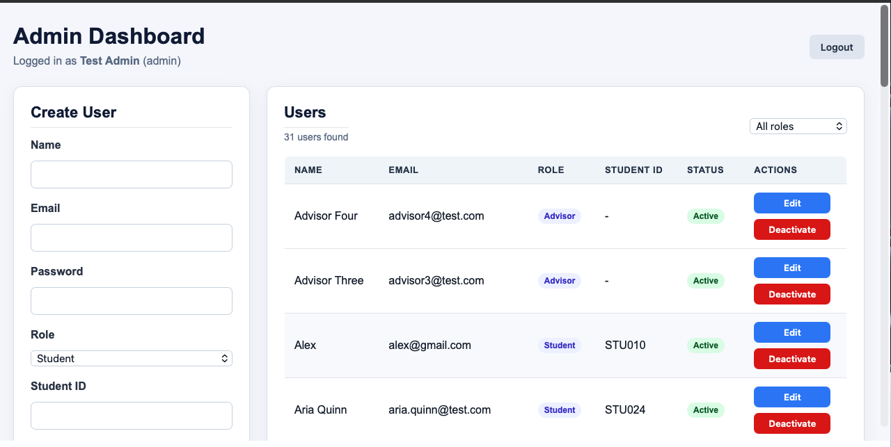
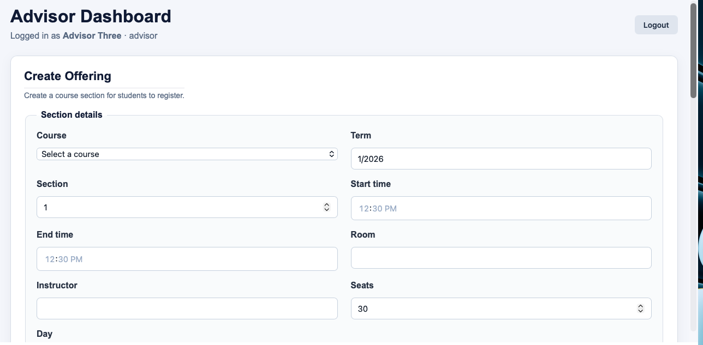
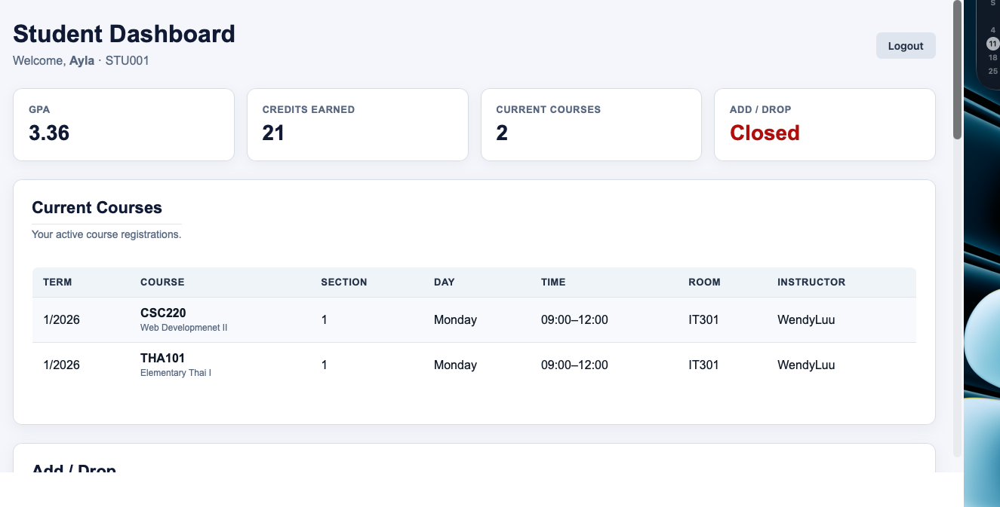

# Group Members

| No. | Name | Student ID | Role |
|---|---|---|---|
| 1 | Phyo Min Tun | 2403040008 | User 1 - Database & Project Setup |
| 2 | Oggha Gwan Myint | 2310060003 | User 2 - Authentication & Admin |
| 3 | Zin Lin Htet| 2311070007 | User 3 - Advisor Features |
| 4 | Vladislav Ivanitskii | 2311080008 | User 4 - Eligibility Rules |
| 5 | Vadim Bushtruk | 2311130002 | User 5 - Student Dashboard & Integration |

---

# Course Registration System (CSC220)

# Course Registration System (CSC220)

A simple MERN web application for course registration with three roles:
**Admin**, **Advisor** and **Student**.

## Screenshots

### Admin Dashboard


### Advisor Dashboard


### Student Dashboard


- **Frontend:** React + Vite (`client/`)
- **Backend:** Node.js + Express (`server/`)
- **Database:** MongoDB Atlas + Mongoose
- **Security:** passwords hashed with bcrypt, logins use JWT

---

## Features

### Admin
- View all users and filter by role
- Create, edit and deactivate users
- An admin cannot deactivate themselves and the system always keeps one active admin

### Advisor
- Create, edit and delete course offerings (term, section, day, time, room, instructor, seats)
- See seats taken and seats remaining
- Select a student and view their academic record
- Register a student or remove a registration (seat counts stay correct)
- See eligible and blocked courses with the reason, e.g. already passed,
  section full, time clash, and **Retake required** for failed courses
- Open or close Add/Drop for a term

### Student
- See current courses with section, day, time, room and instructor
- See previous academic records grouped by term with grades
- **Retake required** shown for F grades
- GPA and total credits earned
- Add/Drop status (Open / Closed). When open: Request Add/Drop
  instructions, a downloadable form, the advisor's email and the
  required email subject

---

## Requirements

- [Node.js](https://nodejs.org/) 22 (LTS) or newer
- A MongoDB Atlas database (ask the team for the connection string)
- Your computer's IP address added in Atlas under **Security > Network Access**
  (or the server will fail with "Could not connect to any servers")

---

## Setup (first time)

```bash
# 1. Get the code
git clone https://github.com/Kophyo12/course-registration-system.git
cd course-registration-system

# 2. Install packages
cd server
npm install
cd ../client
npm install
cd ..
```

3. Create `server/.env` by copying `server/.env.example`, then fill in
   `MONGO_URI` and `JWT_SECRET`. Keep `PORT=5001`.

4. **Only if the database is empty**, load the sample data:

   ```bash
   cd server
   npm run seed
   ```

   > Warning: `npm run seed` **deletes all existing data** before loading the
   > sample data. Do not run it on the shared team database unless everyone agrees.

---

## Running the app

Open two terminals:

```bash
# Terminal 1 - backend (http://localhost:5001)
cd server
npm run dev
```

```bash
# Terminal 2 - frontend (http://localhost:5173)
cd client
npm run dev
```

The backend should print `Server running on port 5001` and `MongoDB connected`.
Then open **http://localhost:5173** and log in.

---

##Screenshots of the pages


## Test accounts

All seeded accounts use the password **`Password123!`**

| Role | Email | Good for showing |
|---|---|---|
| Admin | `admin@test.com` | User management |
| Advisor | `advisor3@test.com` | Offerings, registration, eligibility, Add/Drop |
| Student | `ayla@gmail.com` | Current courses, records by term, a W grade, GPA |
| Student | `noah.reed@test.com` | **Retake required** for an F grade |

To show the Add/Drop request section: log in as the advisor, open
Add/Drop for term `1/2026`, then log in as a student.

---

## How Add/Drop works

1. The advisor opens Add/Drop for a term.
2. The student dashboard shows **Open** and a **Request Add/Drop** section.
3. The student downloads the form (`client/public/add-drop-form.pdf`), fills it in
   and emails it to their advisor with the subject
   `Add/Drop Request - <Student ID> - <Name> - <Term>`.
4. The advisor registers or removes the courses in the Advisor dashboard.
   The eligibility rules are checked on the server.

---

## API overview

| Area | Routes (all under `/api`) | Who |
|---|---|---|
| Auth | `POST /auth/login`, `GET /auth/me` | everyone |
| Admin | `GET/POST /admin/users`, `PATCH/DELETE /admin/users/:id` | admin |
| Advisor | `/advisor/courses`, `/advisor/offerings`, `/advisor/students`, `/advisor/students/:id/records`, `/advisor/students/:id/registrations`, `/advisor/students/:id/eligible-courses`, `/advisor/registrations`, `/advisor/add-drop` | advisor |
| Student | `GET /student/registrations`, `GET /student/records`, `GET /student/add-drop` | student (own data only) |

Every protected route checks the JWT and the role on the server, not just in React.

---

## Running tests

```bash
cd server
npm test
```

Runs the eligibility rule tests. The integration tests only run against a
local test database. See `HANDOFF.md` (User 4) for details.

---

## Project structure

```
client/                React frontend
  public/add-drop-form.pdf
  src/api.js           apiFetch() adds the login token to every request
  src/pages/           Login, AdminDashboard, AdvisorDashboard, StudentDashboard
server/                Express backend
  config/db.js         MongoDB connection
  models/              User, Course, Offering, Registration, Record
  controllers/         auth, admin, advisor, student logic
  routes/              URL to controller mapping
  middleware/          requireAuth and requireRole
  services/            eligibility rules
  seed/                sample data and seed script
  tests/               automated tests
screenshots/           dashboard screenshots used below
HANDOFF.md             notes from each team member
```

## Troubleshooting

| Problem | Fix |
|---|---|
| `MongoDB connection failed ... IP that isn't whitelisted` | Add your IP in Atlas > Security > Network Access |
| `Failed to fetch` on the login page | The backend is not running, or it is not on port 5001 |
| `Invalid or expired token` | Log out and log in again (tokens last 1 day) |
| Port already in use | Close the other terminal running the server or client |
